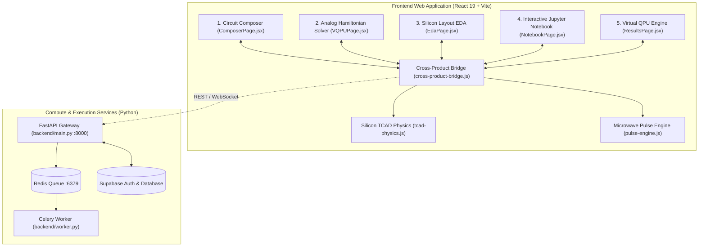

# Alpha-Paradox: Quantum Workload Manager & Q-EDA Platform

[](LICENSE)
[](https://react.dev)
[](https://vitejs.dev)
[](https://fastapi.tiangolo.com)
[](https://qiskit.org)
[](https://docker.com)

**Alpha-Paradox** is an enterprise-grade, cloud-native Quantum Electronic Design Automation (**Q-EDA**) and Workload Management platform. It provides an unbroken workflow spanning from abstract OpenQASM algorithmic circuit design to physical superconducting transmon layout, first-principles TCAD electrodynamics, microwave pulse synthesis, and QLDPC virtual QPU execution.

---

## Architecture Overview



---

## Key Capabilities

### 1. Quantum Circuit Composer
- Interactive multi-qubit grid with drag-and-drop gate placement ($H$, $X$, $Y$, $Z$, $S$, $T$, $CX$, $CZ$, $SWAP$, parameter rotation gates).
- Real-time OpenQASM 2.0 roundtrip generation and syntax synchronization.
- Real-time client-side Statevector, Stabilizer, and Density Matrix simulation.

### 2. First-Principles Silicon TCAD & cQED Engine
- **Conformal Mapping Electrostatics**: Solves Maxwell partial capacitance matrices ($C_\Sigma = C_{\text{pad}} + \frac{1}{2} C_{\text{gnd}} + C_J$) via complete elliptic integrals $K(k_1)/K(k_1')$ evaluated with the Arithmetic-Geometric Mean (AGM) algorithm.
- **Transmon Hamiltonian Perturbation**: Solves Koch et al. energy spectra:
  $$\hbar\omega_{01} = \sqrt{8 E_C E_J} - E_C - \frac{E_C^2}{4\sqrt{8 E_C E_J}}$$
  $$\alpha = \omega_{12} - \omega_{01} \approx -E_C \left(1 + \frac{3}{8}\sqrt{\frac{2 E_C}{E_J}}\right)$$
- **Quantum Zero-Point Fluctuations (ZPF)**: Evaluates ground-state minimum-uncertainty wavepacket spreads ($\Delta\phi \cdot \Delta n = 0.500$) and characteristic impedance $Z_{\text{char}}$.
- **Charge-Noise Immunity**: Derives exponential dephasing suppression $\epsilon_{01}$ in the $E_J / E_C > 50$ transmon phase regime.

### 3. Physical Layout & Silicon EDA
- Parametric coplanar waveguide (CPW) resonators, Xmon / TransmonCross, StarQubit, and Tunable Couplers.
- Automated CPW routing with collision detection and bend radii constraints.
- Direct fabrication export to **GDSII** format via `gdspy`.

### 4. Analog Schrödinger Hamiltonian Engine
- Visual node graph powered by `@xyflow/react` modeling quantum spatial dimensions, arbitrary potential wells $V(\phi)$, and kinetic differential operators.
- Tridiagonal Schrödinger eigensolver computing ground and excited state wavefunctions $\psi_n(\phi)$ and eigenenergies $E_n$.

### 5. Cross-Product Multi-Bridge
- In-memory reactive orchestration layer ([`cross-product-bridge.js`](src/quantum-engine/cross-product-bridge.js)) enabling live bi-directional sync across all 5 products (**Notebook $\leftrightarrow$ Composer $\leftrightarrow$ Analog $\leftrightarrow$ EDA $\leftrightarrow$ vQPU**).

---

## Repository Structure

```
.
├── backend/                  # FastAPI Gateway, Celery Workers, Kernel Manager
│   ├── alpha_metal/          # Qiskit Metal component libraries
│   ├── eda/                  # Layout routing & DRC routines
│   ├── plugins/              # Extensible quantum algorithms & noise models
│   ├── Dockerfile            # Container build specification
│   ├── main.py               # REST & WebSocket API gateway
│   ├── vqpu_engine.py        # QLDPC BP-OSD error decoder & vQPU simulation
│   ├── worker.py             # Asynchronous Celery simulation worker
│   └── requirements.txt      # Python dependencies
├── docs/                     # Technical specifications & architecture guides
│   └── COMMERCIALIZATION.md  # Q-EDA platform executive summary
├── k8s/                      # Kubernetes production deployment manifests
├── public/                   # Static web assets
├── scripts/                  # Development, migration & utility scripts
├── sdk/                      # alpha_paradox Python client SDK
├── src/                      # Frontend Application (React 19 + Vite)
│   ├── components/           # UI components (composer, analog, eda, notebook)
│   ├── pages/                # Top-level view routing
│   ├── quantum-engine/       # TCAD physics, pulse engine & cross-product bridge
│   ├── stores/               # Zustand reactive global state stores
│   └── utils/                # Mathematical helpers & dynamic attributes
├── tests/                    # Organized automated test suite
│   ├── e2e/                  # Playwright browser integration tests
│   ├── integration/          # Kernel gateway & backend tests
│   └── unit/                 # Quantum simulator & physics unit tests
├── .env.example              # Environment configuration template
├── .gitignore                # Production Git exclusion rules
├── docker-compose.yml        # Multi-container orchestration (Redis, API, Worker, UI)
├── package.json              # Frontend dependencies and scripts
└── vite.config.js            # Vite build configuration
```

---

## Quick Start

### Option A: Docker Compose (Recommended)

To spin up the entire platform (Frontend, FastAPI Gateway, Redis, and Celery Worker) in a single command:

```bash
docker compose up --build
```
- **Frontend UI**: [http://localhost:5173](http://localhost:5173)
- **Backend API Gateway**: [http://localhost:8000/docs](http://localhost:8000/docs)

---

### Option B: Local Development Setup

#### 1. Prerequisites
- **Node.js**: v18+ (v20+ recommended)
- **Python**: 3.10+
- **Redis**: 6.0+ (for task queueing)

#### 2. Frontend Setup
```bash
# Install dependencies
npm install

# Copy environment template and configure keys
cp .env.example .env

# Start development server
npm run dev
```

#### 3. Backend Setup
```bash
cd backend

# Create and activate virtual environment
python3 -m venv .venv
source .venv/bin/activate  # On Windows: .venv\Scripts\activate

# Install dependencies
pip install -r requirements.txt

# Start Redis (in a separate terminal)
redis-server

# Start the Celery worker
celery -A worker.celery_app worker --loglevel=info

# Start FastAPI API Gateway
uvicorn main:app --host 0.0.0.0 --port 8000 --reload
```

---

## Environment Variables

Configure your `.env` file based on [`.env.example`](.env.example):

| Variable | Description | Default |
| :--- | :--- | :--- |
| `VITE_API_URL` | Endpoint of the FastAPI Gateway | `http://localhost:8000` |
| `VITE_SUPABASE_URL` | Supabase Project URL | `https://your-project.supabase.co` |
| `VITE_SUPABASE_ANON_KEY` | Supabase Public Anonymous Key | `your-anon-key` |
| `VITE_GEMINI_API_KEY` | Optional AI Co-Pilot integration key | `your-api-key` |

---

## Quality Assurance & Testing

```bash
# Run production frontend build
npm run build

# Run linting check
npm run lint

# Run Playwright E2E tests
npx playwright test
```

---

## License

This project is licensed under the Apache License 2.0. See [LICENSE](LICENSE) for details.
